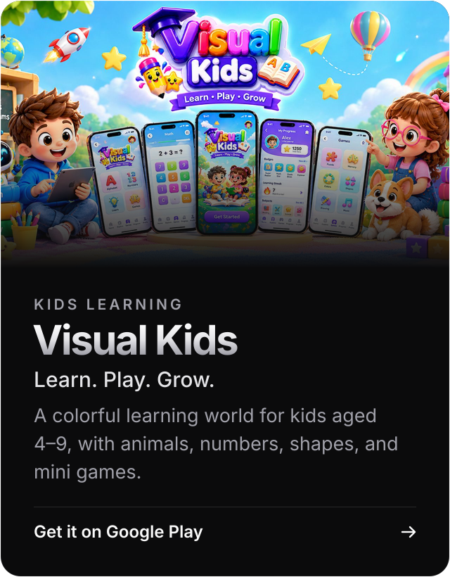
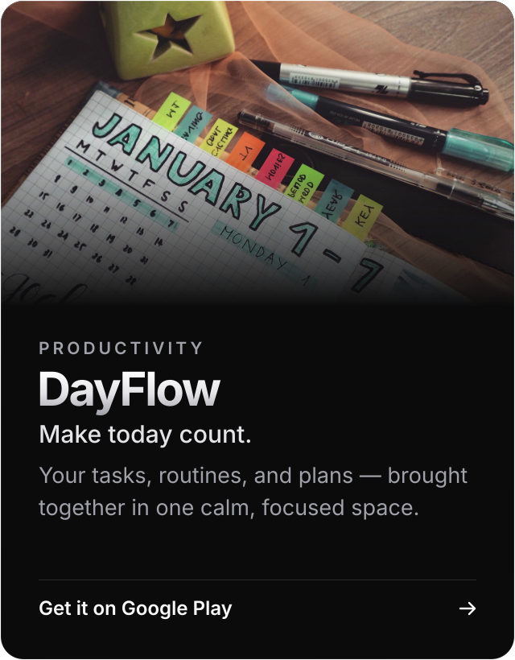
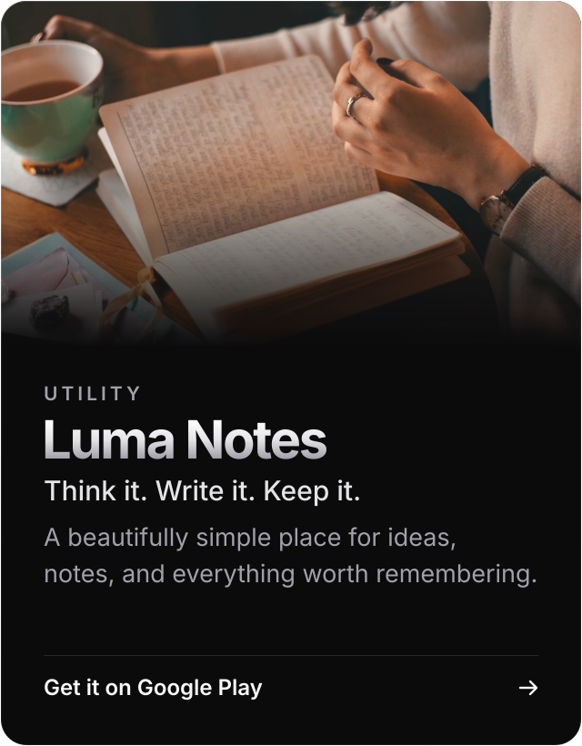
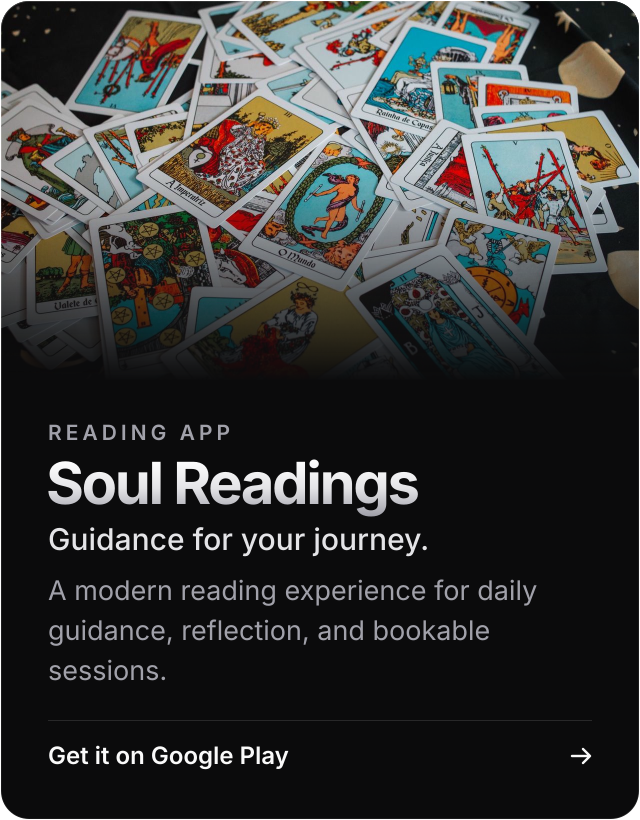
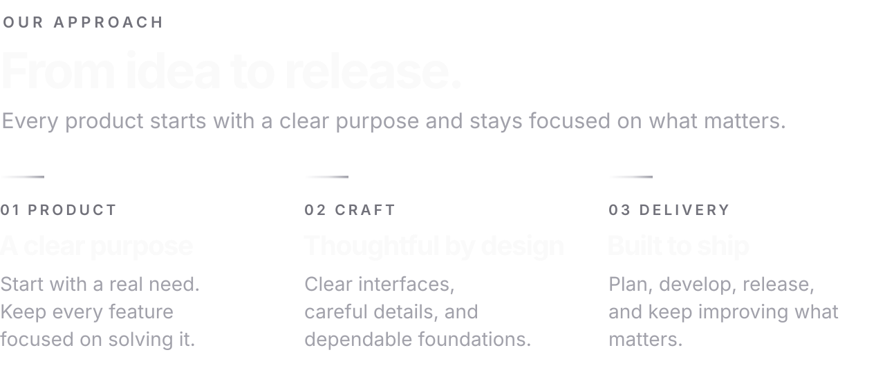
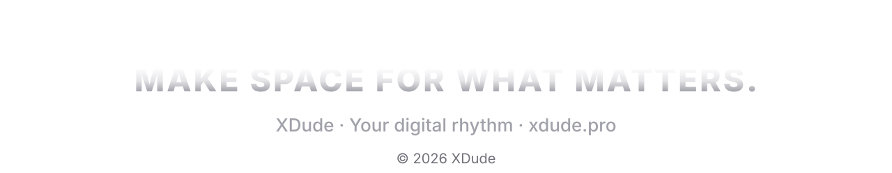

<!--
  XDude — Product Studio
  Palette (xdude.pro): Black #050505 · Zinc #A1A1AA / #71717A · Soft #E4E4E7 · White · Chrome
-->

  

 

  
  
  
  

 
 

 
 
 

  <picture>
    <source media="(prefers-color-scheme: dark)" srcset="./assests/head-collection-dark.svg" />
    <source media="(prefers-color-scheme: light)" srcset="./assests/head-collection-light.svg" />
    
  </picture>

 

  
  

  
  

 
 
 

  <picture>
    <source media="(prefers-color-scheme: dark)" srcset="./assests/approach-dark.svg" />
    <source media="(prefers-color-scheme: light)" srcset="./assests/approach-light.svg" />
    
  </picture>

 
 

  <picture>
    <source media="(prefers-color-scheme: dark)" srcset="./assests/stack-dark.svg" />
    <source media="(prefers-color-scheme: light)" srcset="./assests/stack-light.svg" />
    
  </picture>

 
 
 

 
 

  <picture>
    <source media="(prefers-color-scheme: dark)" srcset="./assests/footer-dark.svg" />
    <source media="(prefers-color-scheme: light)" srcset="./assests/footer-light.svg" />
    
  </picture>

