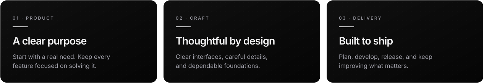

<!-- =========================================================
  XDude — Product Studio Profile
  Brand: Black #050505 · Zinc greys · White · Chrome (xdude.pro theme)
========================================================= -->

  

 

  
  
  
  

 

  

 

## `01` &nbsp;About XDude

 

## `02` &nbsp;The Collection

A growing collection of software built around things worth doing better.

 

  
  

  
  

  

 

## `03` &nbsp;Our Approach

From idea to release.

 

 
 

## `04` &nbsp;Technology Stack

 

   
  
  
  
  
  

 

## `05` &nbsp;Let's Talk

 

  
  
  

 

  
   
  © 2026 XDude · Crafted with intention

